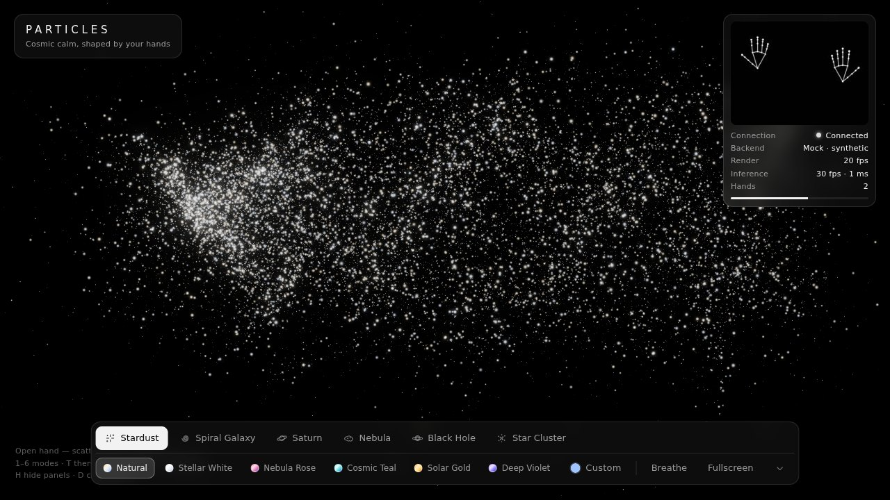
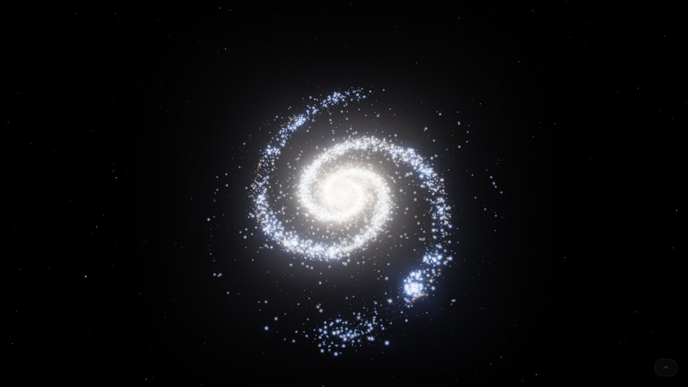
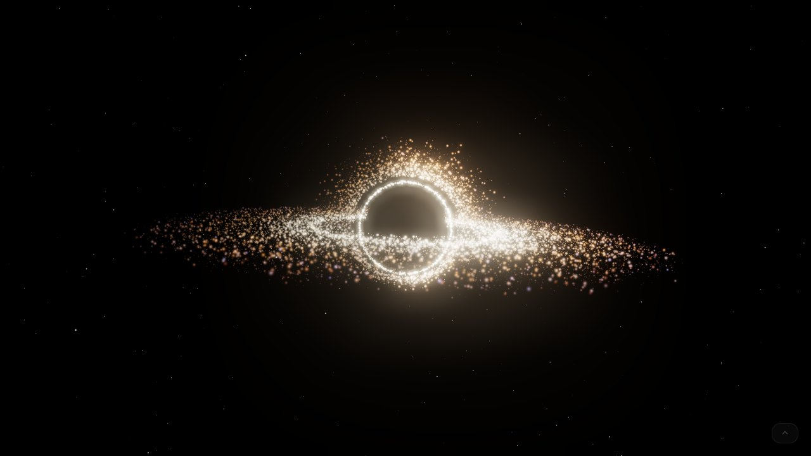
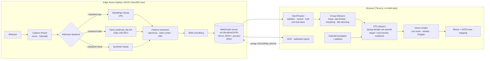

# Particles

**A real-time, gesture-controlled cosmic particle system for calm and focus.**
Tens of thousands of glowing particles form stardust, a spiral galaxy, Saturn, a nebula, a black hole or a globular star cluster. Open your hand and the particles are blown apart like stardust. Close it into a fist and they drift back together. A built-in breathing guide (4-4-6) turns the gather/scatter rhythm into a visual pacer for slow breathing.

> ASUS UGen AI League hackathon prototype · Theme: **Creator AI** · Track: **Battlefield Lightning**
> Target hardware: **ASUS UGen300 (Hailo-10H NPU)**



| Spiral Galaxy | Black Hole |
|---|---|
|  |  |

<sub>Screenshots: `--backend mock` (synthetic hands), captured in headless Chromium with a software renderer. The FPS shown is that renderer's, not a GPU's.</sub>

---

## Why

Stress relief and mindfulness apps are mostly passive: you watch or listen. Slow, paced breathing is a well-established relaxation technique, and an **active, embodied interaction**, where your own movement shapes what you see, makes it easier to stay with it. Most interactive installations, though, need special sensors or a cloud GPU.

Particles needs only a webcam. Hand pose estimation runs **locally** (CPU today, the UGen300 NPU next), so no video ever leaves the device. The output is an ambient visual that responds to the body in real time. It works as a desk companion, a waiting-room installation, a stage visual for creators, or a breathing coach.

## Features

- **Real-time hand tracking**: 21 keypoints per hand, up to two hands, at about 30 Hz, mirrored like a selfie view
- **Gather ↔ scatter, not zoom**: the camera and particle sizes never change. Gestures move *each particle* individually:
  - Open hand → every particle drifts away along its own random direction, carried by **curl noise**, at slightly different speeds
  - Fist → particles return through **spring-damper physics**, each arriving at a slightly different time
  - Continuous and linear: a half-open hand gives half the scatter. No thresholds or on/off states.
  - Speed follows your fingers: close slowly and the particles gather slowly; close fast and they gather faster, up to a calm maximum
- **Your state is kept**: when your hands leave, the particles stay exactly as you left them, drifting very slightly. When a hand returns, control resumes smoothly from there. `R` / **Reset** returns to the mode's default shape.
- **Raise and lower your hand freely**: a hand only takes control once it is steady (0.4 s), openness pauses during fast moves, and when a hand is lowered quickly out of view the state is rolled back to just before that motion
- **Idle dimming**: after 60 s without a hand or a noticeable gesture, the particles fade very slowly to 18% brightness while ~4% stay lit and twinkle like bright stars. A detected hand restores full brightness within 1.5 s. The background sky never dims.
- **Stardust mode** (default): ivory/silver dust fills the screen. A detected hand pulls it into a cloud that **follows the palm** with a dragging delay. With two hands, the dust splits into two clouds.
- **5 realistic celestial templates** that smoothly morph into each other: Spiral Galaxy · Saturn · Nebula · Black Hole · Star Cluster
- **Realistic rendering**: power-law sizes and brightness (most faint, a few brilliant), additive blending + **UnrealBloom**, ACES tone mapping, subtle twinkle, rotating disks, drifting gas, a multi-layer **parallax starfield** and a faint **Milky Way** band
- **Color system**: per-particle palette coloring (warm cores, cool outskirts, dark-red dust), a realistic *Natural* theme, 5 preset themes, and a custom color with an auto-generated palette
- **Breathing guide**: inhale 4 s, hold 4 s, exhale 6 s. The particles scatter as you inhale and gather as you exhale.
- **Debug panel** (`D`): live per-hand state (*Controlling / Stabilizing*), group state (*Held*), openness, tip ratio, palm coordinates and speed, idle time and brightness. Sliders tune `FIST_RATIO` / `OPEN_RATIO` (sent to the server) and every motion, stability and dimming constant. All values are saved in the browser.
- **Adaptive quality**: the particle count scales between 8k and 32k to hold about 60 fps
- **Minimal UI**: semi-transparent panels with line icons that collapse for full immersion (`H`), plus a camera preview with skeleton, FPS, the active backend (CPU / UGen300) and connection status
- **Resilient**: the WebSocket reconnects automatically, and the visuals keep running (holding their state) while the backend is offline. Gesture handling never depends on which panels are visible.

## Modes

| Mode | Formed | Open hand | Motion |
|---|---|---|---|
| **Stardust** | Dense cloud centered on your palm (one cloud per hand) | Dust spreads back over the whole screen | Follows the palm with spring drag; slow floating |
| **Spiral Galaxy** | 2 logarithmic arms, warm bulge, dark-red dust lanes, blue star clusters, ~33° inclination | Stars blown outward | Slow rigid rotation |
| **Saturn** | Banded oblate planet with limb darkening, razor-thin C/B/A rings with the Cassini division | Planet and rings scatter | Keplerian ring motion |
| **Nebula** | 3D fractal-noise gas with filaments, H-alpha red vs OIII teal regions, embedded young stars | Gas dissipates | Curl-noise gas flow |
| **Black Hole** | Dark shadow, thin photon ring, accretion disk (hotter inside), lensed far-side arcs above and below, Doppler-brightened side | Disk tears apart | Keplerian disk (inner orbits faster) |
| **Star Cluster** | Globular cluster (Plummer profile): very dense core, sparse halo, red giants, blue stragglers | Stars disperse | Slow rotation |

Celestial objects stay centered; your hands control how much they are scattered or re-formed. With no hands, every template rests in its formed shape and keeps its natural motion.

## Color system

Each particle stores a **palette coordinate** `c ∈ [0, 1]` chosen by its template, based on its physical role:

| `c` | Role | Examples |
|---|---|---|
| 0.00 | dust / shadow | galaxy dust lanes |
| 0.25 | warm / hot | galactic bulge, red giants |
| 0.50 | bright core | photon ring, hottest inner disk |
| 0.75 | body | ring material, planet bands |
| 1.00 | cool / outer | spiral arms, blue clusters |

Every palette has 5 stops in this role order, so any palette can color any template and the gradients stay natural.

- **Natural** (default): Stardust is ivory/silver; each celestial template uses its own palette inspired by true-color astrophotography (for example H-alpha red and OIII teal for the nebula, and white-hot to deep orange for the accretion disk).
- **Presets**: Stellar White · Nebula Rose · Cosmic Teal · Solar Gold · Deep Violet
- **Custom**: pick one base color; the app derives a 5-stop palette within about ±20° of hue, varying lightness and saturation.
- Theme and template changes **cross-fade** colors smoothly.

## Architecture



### Gather / scatter physics

For every particle, each frame:

```
formed     F = template point (spun + tilted)    or   palm position + cloud offset  (Stardust)
scattered  S = F + random_dir · random_dist       or   its own spot on the full screen (Stardust)
o          = group scatter (follows the hand's openness linearly, rate-limited)
target     = F + (S − F) · o
accel      = ω_i² (target − p) − 2ζω_i (v − v_F)      # spring-damper, ω_i random per particle
```

The group scatter `o` comes from the hand's openness through a short low-pass (`scatterSmoothing`) and a speed limit (`maxScatterSpeed` per second). Slow finger movements are followed at their own pace; fast ones are capped.

`ω_i` is a random base frequency (1.6–4.2 rad/s) times `springStiffness`. `v_F` (the formed shape's own velocity) is fed forward, so rotating disks are tracked exactly. Stardust leaves it out on purpose to create the dragging delay. The GPU adds divergence-free curl noise whose strength grows with the scatter amount.

### Openness metric

```
palm_size  = |middle_finger_MCP − wrist|
tip_ratio  = mean(|fingertip_k − wrist|  for k in thumb..pinky) / palm_size
openness   = clip((tip_ratio − FIST_RATIO) / (OPEN_RATIO − FIST_RATIO), 0, 1)   # defaults 1.0 / 1.75
```

Dividing by palm size makes the value independent of how far the hand is from the camera. Distances are computed in isotropic pixel space, so the camera aspect ratio doesn't skew them. Thresholds can be tuned live in the calibration panel.

### WebSocket protocol

Server → browser (≈30 Hz):

```json
{
  "type": "hands", "backend": "cpu", "backend_label": "CPU (MediaPipe)",
  "camera": true, "fps": 29.8, "infer_ms": 9.7,
  "num_hands": 1, "openness": 0.83, "hand_distance": null,
  "hands": [{ "label": "Right", "openness": 0.83, "raw_openness": 0.86, "ratio": 1.62,
              "center": [0.71, 0.48], "score": 0.98 }],
  "thresholds": { "fist_ratio": 1.0, "open_ratio": 1.75 },
  "image": "data:image/jpeg;base64,..."
}
```

`center` is the palm center, normalized to [0, 1] in the **mirrored** frame: moving your hand to your right increases `x`.

`stale` is `true` while the server briefly repeats the last detection after a drop-out (anti-flicker). The browser ignores those frames when it measures hand motion.

Browser → server (calibration): `{"type": "config", "fist_ratio": 0.95, "open_ratio": 1.8}`

### Hand states (raise / use / lower)

```mermaid
stateDiagram-v2
    [*] --> Stabilizing: hand detected
    Stabilizing --> Stabilizing: moving faster than stableSpeed (timer restarts)
    Stabilizing --> Controlling: steady for activationTime
    Controlling --> Controlling: palm faster than fastSpeed → openness paused
    Controlling --> Held: hand gone for LOST_TIMEOUT
    Held --> Held: state kept (look-back to before a fast exit)
    Held --> Controlling: a new hand becomes steady
    Held --> Default: R / Reset, or switching mode
```

When a controlling hand disappears, the tracker looks back over its last `retroLookback` seconds of history (about 1 s is kept). If the palm was moving faster than `fastSpeed`, the held state is taken from just before that fast motion started, minus `RETRO_MARGIN`. Lowering your hand out of view therefore does not drag or change the particles.

### Project layout

```
particles/
├── run.py                 # one-command launcher (server + HTTP + browser)
├── start.sh / start.bat   # create venv on first run, then run.py
├── requirements.txt
├── backend/
│   ├── server.py          # capture loop + WebSocket broadcast + config messages
│   ├── hand_features.py   # tip ratio, openness, palm center, EMA, skeleton drawing
│   ├── backend_cpu.py     # MediaPipe Hands (demo backend)
│   ├── backend_hailo.py   # UGen300 / Hailo-10H interface prototype (untested)
│   └── backend_mock.py    # synthetic moving hands for testing without a camera
├── frontend/
│   ├── index.html         # UI + styles, Three.js via CDN import map
│   ├── main.js            # renderer, bloom, physics, controls, UI wiring
│   └── js/
│       ├── templates.js   # Stardust + 5 celestial point distributions
│       ├── palettes.js    # Natural / preset / custom palettes
│       ├── sky.js         # parallax starfield + Milky Way
│       ├── hands.js       # WebSocket client with auto-reconnect
│       ├── handTracker.js # hand states: stabilize / control / hold, exit look-back
│       ├── tuning.js      # tunable constants + defaults (localStorage)
│       ├── debug.js       # debug panel: live states, sliders
│       └── noise.js       # seeded RNG, simplex noise, fBm
├── docs/                  # README screenshots
└── models/                # put *.hef files here (git-ignored)
```

## Installation & running

**Requirements:** Python **3.9 – 3.12** (MediaPipe 0.10.21 has no wheels for 3.13+), a webcam, and a modern browser with WebGL. The frontend loads Three.js from a CDN, so an internet connection is needed on first load.

### One command

```bash
# Linux / macOS / WSL
./start.sh

# Windows
start.bat
```

On first run this creates `.venv`, installs `requirements.txt`, then starts the inference server and the web server and opens `http://localhost:8000`.

### Manual

```bash
python3.12 -m venv .venv            # or python3.11
source .venv/bin/activate           # Windows: .venv\Scripts\activate
pip install -r requirements.txt
python run.py                       # CPU / MediaPipe (default)
```

### Options

| Command | Description |
|---|---|
| `python run.py` | MediaPipe on CPU, webcam 0 |
| `python run.py --camera 1` | Use another webcam |
| `python run.py --backend mock` | Synthetic hands, **no webcam needed** (good for rehearsals) |
| `python run.py --backend mock --mock-scenario raise` | Mock script: raise a hand → open/close → drop it fast → long idle (`raise`, `sweep` or `all`) |
| `python run.py --backend hailo --hef models/hand_landmark_lite.hef` | UGen300 prototype (see below) |
| `python run.py --no-browser` | Don't open a browser |
| `python run.py --smoothing 0.25` | Extra args are forwarded to `backend/server.py` (lower = smoother) |
| `http://localhost:8000/?n=40000` | Fixed particle count (4k – 80k; disables auto-scaling) |
| `http://localhost:8000/?adaptive=0` | Keep 32k particles even on slow devices |

> **WSL note:** WSL2 doesn't expose USB webcams by default. Run on native Windows/Linux, attach the camera with [`usbipd`](https://learn.microsoft.com/windows/wsl/connect-usb), or use `--backend mock`.

## How to use

### Gestures

| Gesture | Stardust | Celestial templates |
|---|---|---|
| ✊ Fist | Dust gathers into a dense cloud at your palm (tighter fist = denser) | The object re-forms |
| ✋ Open hand | Dust is blown back over the whole screen | The object is blown apart |
| 🤏 Half open | In between: the scatter amount is continuous | In between |
| ↔ Move your hand | The cloud follows your palm with a dragging delay (mirror view) | — |
| 🙌 Two hands | Two clouds, one per hand | Average openness of both hands |
| 👋 Hand leaves | The cloud stays where it was, at the same density | The object stays as scattered as it was |
| ⬆ Raising a hand into view | Ignored until the hand is steady for 0.4 s | Same |
| ⬇ Lowering a hand quickly | Ignored: the state just before the motion is kept | Same |
| No hands at start | Dust fills the screen and floats | Formed object with its natural motion |

Press `R` (or **Reset**) to return to the current mode's default shape: dust spread over the screen, or the fully formed object. Switching modes (`1`–`6`) morphs into the new mode's default shape as before.

**Idle dimming**: when no hand is seen, or no noticeable gesture happens, for 60 s, the particles slowly dim (over 45 s) to 18% while a few bright stars keep twinkling. A hand, a key press or the mouse brings everything back within 1.5 s.

**Breathing mode** (`B`): inhale 4 s → the particles scatter; hold 4 s; exhale 6 s → they gather again (in Stardust, around your hand or the screen center). A faint *Inhale / Hold / Exhale* cue and countdown appear in the center.

### Keyboard shortcuts

| Key | Action |
|---|---|
| `1` – `6` | Stardust · Spiral Galaxy · Saturn · Nebula · Black Hole · Star Cluster |
| `T` | Next color theme |
| `B` | Breathing guide on/off |
| `R` | Reset to the current mode's default shape (smooth) |
| `F` | Fullscreen |
| `H` | Hide / show all panels (immersive mode); a small dot bottom-right still shows the hand state |
| `D` | Debug panel: hand states, calibration and tuning sliders |

### Calibrating gestures

Press `D` and watch the **ratio** of each hand:

1. Make a tight fist and set `FIST_RATIO` slightly **above** the ratio shown.
2. Spread your hand fully and set `OPEN_RATIO` slightly **below** the ratio shown.

Changes apply immediately on the server and are stored in the browser's `localStorage`, then re-applied on the next connection.

### Tuning constants

All constants below live in `frontend/js/tuning.js` and have sliders in the debug panel (`D`). Changes are saved in `localStorage`; *Reset all to defaults* restores them.

| Constant | Default | Meaning |
|---|---|---|
| `springStiffness` | 0.55 | Multiplier on the particle spring frequency (1.0 = the earlier, faster feel) |
| `springDamping` | 0.85 | Spring damping ratio ζ |
| `followDelay` | 0.12 s | Time constant for the dust cloud to follow the palm |
| `maxScatterSpeed` | 0.7 / s | Fastest change of the scatter amount (full range = 1) |
| `scatterSmoothing` | 0.15 s | Low-pass on openness before the speed limit |
| `activationTime` | 0.4 s | A new hand must stay steady this long before it takes control |
| `stableSpeed` | 0.35 frame/s | Palm speed below which a new hand counts as steady |
| `fastSpeed` | 1.0 frame/s | Palm speed above which openness updates pause |
| `retroLookback` | 0.8 s | Window before a hand disappears that is checked for a fast exit |
| `idleSeconds` | 60 s | Idle time before dimming starts |
| `dimDuration` | 45 s | Duration of the fade |
| `dimLevel` | 0.18 | Brightness while idle (background stars are not dimmed) |

Fixed constants: `HISTORY_SECONDS` 1.2 s, `LOST_TIMEOUT` 0.2 s, `RETRO_MARGIN` 0.15 s, `WAKE_SECONDS` 1.5 s, `BRIGHT_STAR_FRACTION` 0.04. Speeds are in frame widths or heights per second (normalized camera coordinates).

## UGen300 deployment (Hailo-10H)

> ⚠️ **`--backend hailo` is an interface prototype and has NOT been tested on real hardware.** The post-processing is not finished and must be completed by whoever deploys it. The demo uses `--backend cpu`.

`backend/backend_hailo.py` uses the HailoRT Python API in the intended structure:

```python
params = VDevice.create_params()
params.scheduling_algorithm = HailoSchedulingAlgorithm.ROUND_ROBIN
with VDevice(params) as vdevice:
    infer_model = vdevice.create_infer_model("hand_landmark_lite.hef")
    infer_model.input().set_format_type(FormatType.UINT8)
    for out in infer_model.outputs:
        out.set_format_type(FormatType.FLOAT32)
    with infer_model.configure() as configured:
        bindings = configured.create_bindings(output_buffers=...)
        bindings.input().set_buffer(roi_224x224_rgb)
        configured.run([bindings], timeout_ms)
```

**Steps to make it work on a UGen300:**

1. Install the UGen300 driver and the **HailoRT** runtime plus its Python wheel (`hailo_platform`) for your OS. The versions must match the device firmware.
2. Get a `hand_landmark_lite.hef` **compiled for Hailo-10H**. Either use a precompiled model from the Hailo Model Zoo if one exists for your HailoRT version, or compile MediaPipe's `hand_landmark_lite` (TFLite/ONNX) with the Hailo Dataflow Compiler. Put it in `models/`.
3. Inspect the outputs with `hailortcli parse-hef models/hand_landmark_lite.hef` and update `_decode()` (tensor order, coordinate range, sigmoid on scores).
4. **Add palm detection.** The landmark model expects a hand-centered crop. Run `palm_detection_lite.hef` first, decode its anchors, apply NMS, and compute the rotated ROI, as in MediaPipe's pipeline. The prototype uses a fixed center crop as a placeholder (`_select_roi()`).
5. Run `python run.py --backend hailo --hef models/hand_landmark_lite.hef`. The HUD then shows **UGen300 · Hailo-10H**.

Everything downstream of `process()` is backend-agnostic: feature extraction, smoothing, WebSocket and renderer stay the same.

**Why the NPU:** offloading both networks frees the CPU/GPU for rendering, lowers power use for always-on installations, and leaves room for heavier models (e.g. full hand mesh or body pose) without dropping below 30 FPS.

## Limitations

- The **Hailo backend is untested** on hardware and lacks palm detection and verified post-processing (see above).
- The default openness thresholds (`FIST_RATIO`, `OPEN_RATIO`) are tuned for a frontal camera; use the calibration panel (`D`) for your setup. Extreme angles (palm edge-on to the camera) reduce accuracy.
- MediaPipe is pinned to **0.10.21** (the last version with the `solutions` API used here), which limits Python to **≤ 3.12**.
- Tracking depends on lighting; low light or busy backgrounds increase jitter and missed detections.
- The spring physics runs on the CPU in JavaScript; curl noise, twinkle and Doppler run on the GPU. The particle count auto-scales (8k – 32k) to hold about 60 fps. Much larger counts would need a GPGPU simulation.
- The celestial objects are artistic, physically *inspired* models (log-spiral arms, Plummer profile, Keplerian disks, a lensing approximation), not physical simulations.
- The frontend loads Three.js from a CDN. For fully offline kiosks, vendor `three.module.js` locally and update the import map.
- The camera preview is sent as base64 JPEG over a local WebSocket. That is fine on localhost but not designed for remote or multi-user streaming.
- Ignoring raise/lower motions is best effort: it relies on palm speed. A hand that rises or drops slowly can still move the particles, and a very still hand entering the frame takes control after 0.4 s. Tune `stableSpeed`, `fastSpeed` and `activationTime` for your setup.
- This is not a medical device. The breathing guide is for relaxation only.

## License

[MIT](LICENSE)
