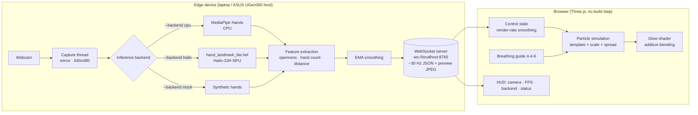

# Particles

**A real-time, gesture-controlled 3D particle system for calm and focus.**
Open your hands and a glowing heart, flower, planet or firework expands and drifts apart. Close them into a fist and it gathers back together. A built-in breathing guide (4-4-6) turns the particles into a visual pacer for slow breathing.

> ASUS UGen AI League hackathon prototype · Theme: **Creator AI** · Track: **Battlefield Lightning**
> Target hardware: **ASUS UGen300 (Hailo-10H NPU)**

---

## Why

Stress relief and mindfulness apps are mostly passive: you watch or listen. Slow, paced breathing is a well-established relaxation technique, and an **active, embodied interaction**, where your own movement shapes what you see, makes it easier to stay with it. Most interactive installations, though, need special sensors or a cloud GPU.

Particles needs only a webcam. Hand pose estimation runs **locally** (CPU today, the UGen300 NPU next), so no video ever leaves the device. The output is an ambient visual that responds to the body in real time. It works as a desk companion, a waiting-room installation, a stage visual for creators, or a breathing coach.

## Features

- **Real-time hand tracking**: 21 keypoints per hand, up to two hands, at about 30 Hz
- **Gesture → particle mapping**
  - Open hands → particles **expand and diffuse**
  - Fist → particles **gather and shrink**
  - Two hands: the **distance between them** scales the shape further
  - Works with **one hand** too
- **24,000 particles** (adjustable with `?n=`) with a soft additive glow shader
- **Smooth morphing** between templates: 3D Heart · Flower · Saturn · Fireworks (periodic bursts)
- **Idle mode**: with no hands detected, particles slowly rotate and float
- **Breathing guide**: inhale 4 s, hold 4 s, exhale 6 s, with a faint *Inhale / Hold / Exhale* cue
- **Minimal UI**: template buttons, color picker, breathing toggle, fullscreen, camera preview with skeleton, FPS, active backend (CPU / UGen300) and connection status
- **Resilient**: the WebSocket reconnects automatically, and the frontend keeps running in idle mode while the backend is offline
- **Jitter-free**: EMA smoothing on the backend plus frame-rate-independent interpolation on the frontend

## Architecture



### Openness metric

```
palm_size  = |middle_finger_MCP − wrist|
tip_ratio  = mean(|fingertip_k − wrist|  for k in thumb..pinky) / palm_size
openness   = clip((tip_ratio − 1.0) / (1.75 − 1.0), 0, 1)       # 0 = fist, 1 = open
```

Dividing by palm size makes the value independent of how far the hand is from the camera. Distances are computed in isotropic pixel space, so the camera aspect ratio doesn't skew them.

### WebSocket message (≈30 Hz)

```json
{
  "type": "hands", "backend": "cpu", "backend_label": "CPU (MediaPipe)",
  "camera": true, "fps": 29.8, "infer_ms": 9.7,
  "num_hands": 2, "openness": 0.83, "hand_distance": 0.62,
  "hands": [{ "label": "Left", "openness": 0.91, "raw_openness": 0.95, "center": [0.31, 0.55], "score": 0.98 }],
  "image": "data:image/jpeg;base64,..."
}
```

### Project layout

```
particles/
├── run.py                 # one-command launcher (server + HTTP + browser)
├── start.sh / start.bat   # create venv on first run, then run.py
├── requirements.txt
├── backend/
│   ├── server.py          # capture loop + WebSocket broadcast
│   ├── hand_features.py   # openness, distance, EMA, skeleton drawing
│   ├── backend_cpu.py     # MediaPipe Hands (demo backend)
│   ├── backend_hailo.py   # UGen300 / Hailo-10H interface prototype (untested)
│   └── backend_mock.py    # synthetic hands for testing without a camera
├── frontend/
│   ├── index.html         # UI + styles, Three.js via CDN import map
│   └── main.js            # particles, templates, gestures, breathing, WebSocket
└── models/                # put *.hef files here (git-ignored)
```

## Installation & running

**Requirements:** Python **3.9 – 3.12** (MediaPipe 0.10.21 has no wheels for 3.13+), a webcam, and a modern browser with WebGL. The frontend loads Three.js from a CDN, so an internet connection is needed on first load.

### One command

```bash
# Linux / macOS / WSL
./start.sh

# Windows
start.bat
```

On first run this creates `.venv`, installs `requirements.txt`, then starts the inference server and the web server and opens `http://localhost:8000`.

### Manual

```bash
python3.12 -m venv .venv            # or python3.11
source .venv/bin/activate           # Windows: .venv\Scripts\activate
pip install -r requirements.txt
python run.py                       # CPU / MediaPipe (default)
```

### Options

| Command | Description |
|---|---|
| `python run.py` | MediaPipe on CPU, webcam 0 |
| `python run.py --camera 1` | Use another webcam |
| `python run.py --backend mock` | Synthetic hands, **no webcam needed** (good for rehearsals) |
| `python run.py --backend hailo --hef models/hand_landmark_lite.hef` | UGen300 prototype (see below) |
| `python run.py --no-browser` | Don't open a browser |
| `python run.py --smoothing 0.25` | Extra args are forwarded to `backend/server.py` (lower = smoother) |
| `http://localhost:8000/?n=40000` | Change the particle count (5k – 60k) |

> **WSL note:** WSL2 doesn't expose USB webcams by default. Run on native Windows/Linux, attach the camera with [`usbipd`](https://learn.microsoft.com/windows/wsl/connect-usb), or use `--backend mock`.

## How to use

| Gesture / key | Effect |
|---|---|
| ✋ Open hand(s) | Particles expand and diffuse |
| ✊ Fist | Particles gather and shrink |
| 🙌 Move two hands apart / together | Shape grows / shrinks further |
| No hands | Idle: slow rotation and floating |
| `1` `2` `3` `4` | Heart · Flower · Saturn · Fireworks |
| `B` | Toggle breathing guide (inhale 4 s · hold 4 s · exhale 6 s) |
| `F` | Fullscreen |

**Breathing mode:** the breathing rhythm controls the size of the shape. Your hands still adjust it gently, so you can "hold" the breath with open palms. Follow the shape: breathe in as it grows, hold, and breathe out slowly as it shrinks.

## UGen300 deployment (Hailo-10H)

> ⚠️ **`--backend hailo` is an interface prototype and has NOT been tested on real hardware.** The post-processing is not finished and must be completed by whoever deploys it. The demo uses `--backend cpu`.

`backend/backend_hailo.py` uses the HailoRT Python API in the intended structure:

```python
params = VDevice.create_params()
params.scheduling_algorithm = HailoSchedulingAlgorithm.ROUND_ROBIN
with VDevice(params) as vdevice:
    infer_model = vdevice.create_infer_model("hand_landmark_lite.hef")
    infer_model.input().set_format_type(FormatType.UINT8)
    for out in infer_model.outputs:
        out.set_format_type(FormatType.FLOAT32)
    with infer_model.configure() as configured:
        bindings = configured.create_bindings(output_buffers=...)
        bindings.input().set_buffer(roi_224x224_rgb)
        configured.run([bindings], timeout_ms)
```

**Steps to make it work on a UGen300:**

1. Install the UGen300 driver and the **HailoRT** runtime plus its Python wheel (`hailo_platform`) for your OS. The versions must match the device firmware.
2. Get a `hand_landmark_lite.hef` **compiled for Hailo-10H**. Either use a precompiled model from the Hailo Model Zoo if one exists for your HailoRT version, or compile MediaPipe's `hand_landmark_lite` (TFLite/ONNX) with the Hailo Dataflow Compiler. Put it in `models/`.
3. Inspect the outputs with `hailortcli parse-hef models/hand_landmark_lite.hef` and update `_decode()` (tensor order, coordinate range, sigmoid on scores).
4. **Add palm detection.** The landmark model expects a hand-centered crop. Run `palm_detection_lite.hef` first, decode its anchors, apply NMS, and compute the rotated ROI, as in MediaPipe's pipeline. The prototype uses a fixed center crop as a placeholder (`_select_roi()`).
5. Run `python run.py --backend hailo --hef models/hand_landmark_lite.hef`. The HUD then shows **UGen300 · Hailo-10H**.

Everything downstream of `process()` is backend-agnostic: feature extraction, smoothing, WebSocket and renderer stay the same.

**Why the NPU:** offloading both networks frees the CPU/GPU for rendering, lowers power use for always-on installations, and leaves room for heavier models (e.g. full hand mesh or body pose) without dropping below 30 FPS.

## Limitations

- The **Hailo backend is untested** on hardware and lacks palm detection and verified post-processing (see above).
- The openness thresholds (`FIST_RATIO`, `OPEN_RATIO` in `hand_features.py`) are tuned for a frontal camera. Extreme angles (palm edge-on to the camera) reduce accuracy.
- MediaPipe is pinned to **0.10.21** (the last version with the `solutions` API used here), which limits Python to **≤ 3.12**.
- Tracking depends on lighting; low light or busy backgrounds increase jitter and missed detections.
- The particle simulation runs on the CPU in JavaScript (about 24k particles at 60 FPS on a typical laptop). Much larger counts would need a GPU (GPGPU) simulation.
- The frontend loads Three.js from a CDN. For fully offline kiosks, vendor `three.module.js` locally and update the import map.
- The camera preview is sent as base64 JPEG over a local WebSocket. That is fine on localhost but not designed for remote or multi-user streaming.
- This is not a medical device. The breathing guide is for relaxation only.

## License

[MIT](LICENSE)
